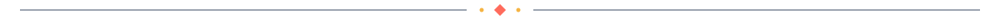

<h1 align="center">🛰️ Signal, not noise</h1>

  

<h2 align="center">🔭 Coverage</h2>

|    | Area | Coverage |
|:--:|:-----|:---------|
| 🔴 | AI & agent security | `████████░░` |
| 🟠 | Security tooling & automation | `██████░░░░` |
| 🟡 | Application security | `████░░░░░░` |
| 🟡 | Detection engineering | `███░░░░░░░` |
|    | also: vuln management · email security · zero-trust access | `··········` |

hand-tuned, not auto-generated. the interesting repos are private.

 

<table>
  <tr>
    <td align="right">writes</td>
    <td>Python · SQL · Terraform · Bash</td>
  </tr>
  <tr>
    <td align="right">reviews</td>
    <td>Ruby · Go · TypeScript · Swift/Kotlin</td>
  </tr>
</table>

  

<!-- footer image slot:

  

-->
